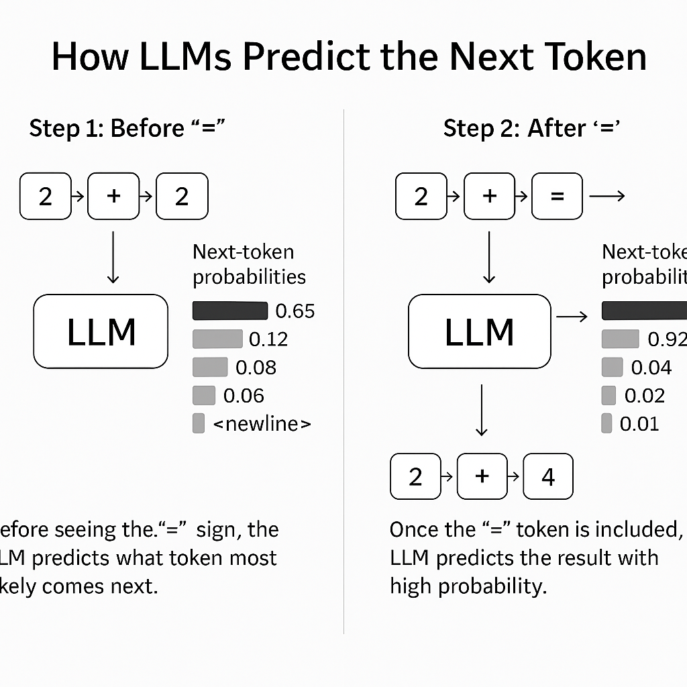
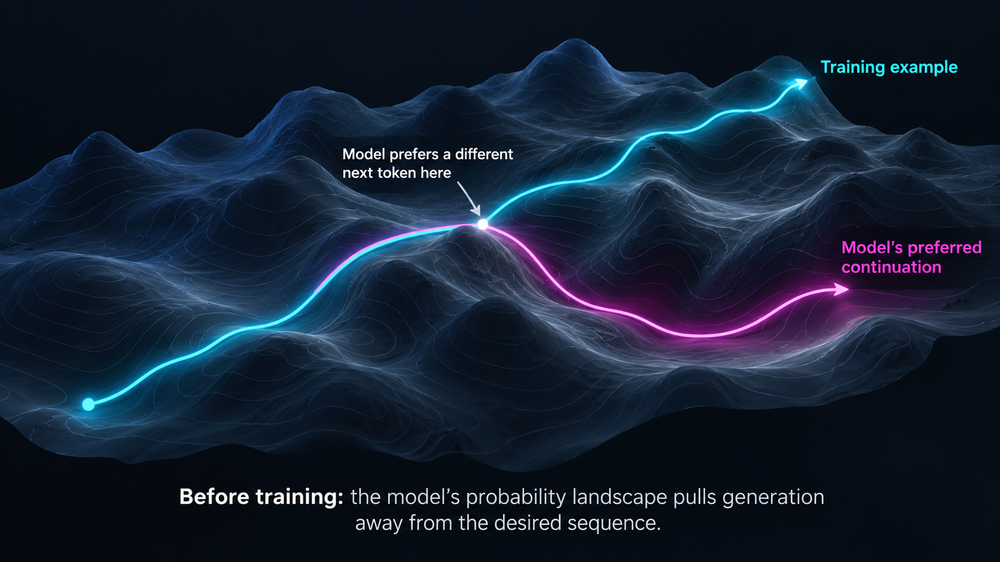
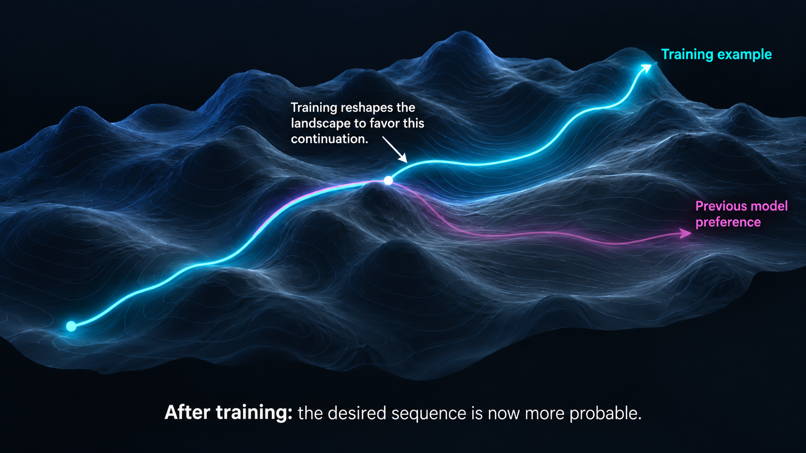
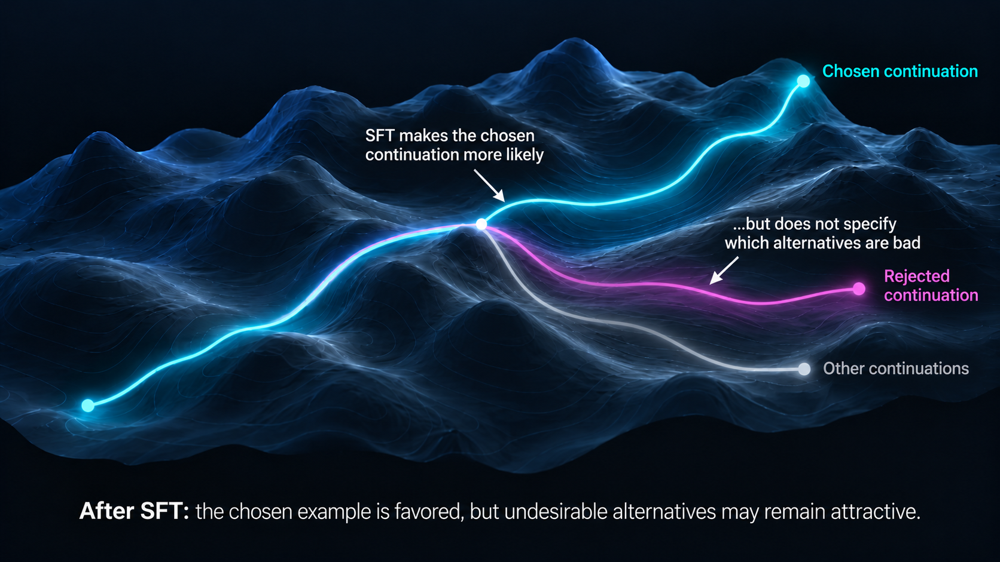
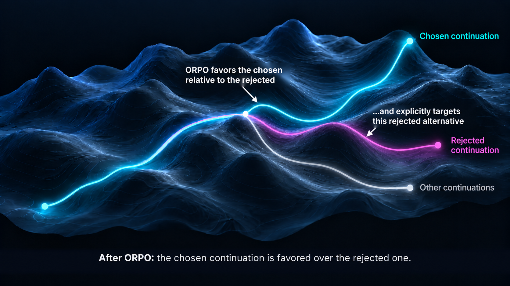
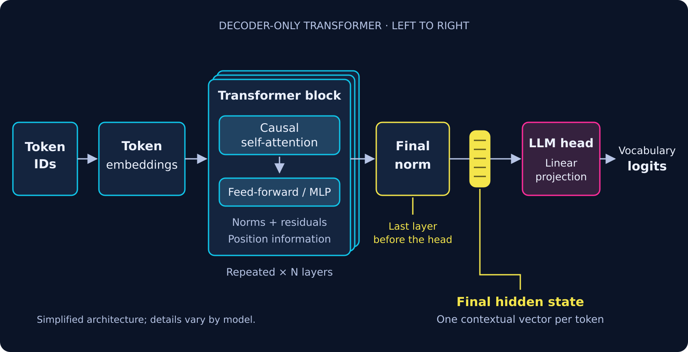
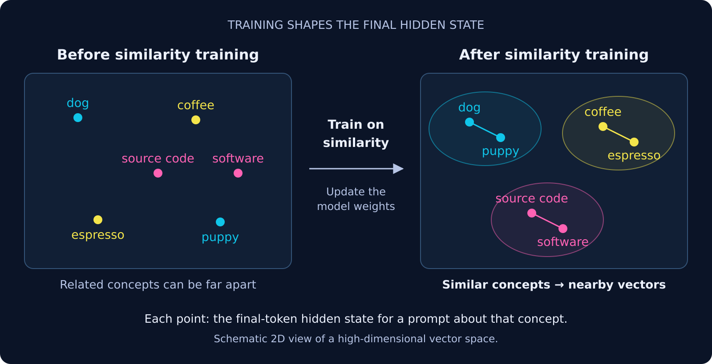

<!-- Treat as reveal.js with no part slides (heading 1 is a new slide) -->

# Interesting AI

::: {.title-slide}
::: {.org}
Hadron Industries
:::

::: {.title-grid}
::: {.title-copy}
**Sam Hartman**

October 30, 2026
:::

::: {.logo-card}

:::
:::
:::

<audio src="ai_intro.ogg"></audio>

# How LLMs Predict the Next Token

 have smaller probabilities. Panel 2 is titled “Step 2: After ‘=’.” It shows tokens 2, plus, 2, equals flowing into the LLM box. The output side shows next-token probabilities where “4” has very high probability (around 0.92) and alternative tokens like 3, 22, and 5 have much lower probabilities. At the bottom, an example output sequence 2 + 4 is shown, with a caption explaining that once the “=” token is included the LLM predicts the result with high probability.">

# Loading a model
```python
import transformers, torch

model_id = 'google/gemma-4-E4B-it'
m = transformers.AutoModelForCausalLM.from_pretrained(model_id).to('cuda')
t = transformers.AutoTokenizer.from_pretrained(model_id)
```

`m` is the pretrained model, placed on the GPU; `t` is its matching tokenizer.

# Tokenizing a prompt

Models consume **token IDs** rather than raw text. A token may be a word, part of a word, punctuation, whitespace, or a special marker.

```python
input = t('Python is a ', return_tensors='pt')
input = {k:v.to('cuda') for k,v in input.items()}
```

The tokenizer makes PyTorch tensors, then we move them to the model's GPU. Token boundaries are not necessarily word boundaries; inspect them with `t.convert_ids_to_tokens`.

# Calling the model: why four positions?

```python
output = m(**input)
output.logits.shape
# torch.Size([1, 4, 262144])
```

The tokenizer produced **four input token IDs** from `'Python is a '` (tokens are not necessarily words).

- **1**: one input sequence.
- **4**: one position per input token. Each position sees its prefix and scores the *following* token.
- **262,144**: one score for every possible next token at each position.

**One forward pass computes all four positions.** The last one, `output.logits[0, -1]`, predicts what comes **after the entire prompt**.

# What are logits?

A **logit** is an unnormalized score for a candidate next token.

- Higher score means the model favors that candidate more.
- Logits are **not probabilities** (softmax can turn them into probabilities).
- The final position tells us what token might follow our prompt.

```python
output.logits[0, -1]  # scores at the last input position
```

`0` chooses our only input sequence; `-1` chooses its last token position.

# Finding the top ten predictions

```python
topten = torch.topk(output.logits[0,-1], 10)
[t.decode(x) for x in topten.indices]
```

`torch.topk` returns the ten largest logit **values** and their token **indices** (IDs). The tokenizer decodes each ID back into readable text.

This is a **ranking**, not random sampling or text generation.

# The model's top ten next-token candidates

Prompt: `Python is a ` 

```python
['1', '\n', '2', '4', '5', '0', '🐍', ' Python', '3', '\n\n']
```

The candidates are in descending score order. Spaces and newlines matter: `' Python'` starts with a space, while `'\n'` and `'\n\n'` represent line breaks.

These are **alternatives for a single next token**, not a ten-token continuation.

# SFT: Before training



# SFT: After training



# Phase 1: preparing a dataset

Training starts long before the model hits a GPU. The first job is to turn **raw inputs** into a dataset the model can learn from.

Examples come in two shapes, and the shape decides the path:

- **Rounds of a conversation**, for supervised fine-tuning.
- **Plain text** documents, for continued pretraining.

Both end as the same thing: **a chunked, tokenized dataset sized to the model's context size**.

The code lives in the public [ai-tools](https://gitlab.suchdamage.org/hartmans-ai/ai-tools) repository: `prepare.py` builds the examples, `modeling.py` chunks and tokenizes them.

# From files to examples

`prepare.py` takes raw inputs — RST source or EPUB — and **splits them into examples**, one per section.

Each example is a small record: `content`, the chunk itself, plus a `prompt` — a short description of *what this chunk is* (narrator, timeline, universe) built from directives in the source.

That per-chunk prompt is the key idea: **the model learns each example with its context in view**, not as orphaned text. File patterns are declared in YAML, and the result becomes a saved dataset:

```python
ds = datasets.Dataset.from_generator(handle_patterns, ...)
ds.save_to_disk('chunked')
```

Source: [prepare.py](https://gitlab.suchdamage.org/hartmans-ai/ai-tools/-/blob/master/hartmans_ai/prepare.py)

# Chunking and tokenizing

`modeling.py` turns examples into **fixed-size token batches** for the target `context_size`. It is modeled on trl's `ConstantLengthDataset`, with deliberate differences: each chunk is **self-contained** (the example's prompt is prepended to it), we chunk **within an example** rather than across a flat token stream, and `from_generator` keeps the result **savable to disk**.

```python
context_available = context_size - prompt_length
batches = [content_ids[i:i+context_available] ...]
```

So each example's content is cut into the space left after its prompt, and each batch is padded to exactly `context_size`, with an `attention_mask` marking the real tokens.

Source: [modeling.py](https://gitlab.suchdamage.org/hartmans-ai/ai-tools/-/blob/master/hartmans_ai/modeling.py)

# Loss, and no-loss

Not every token should teach the model something: a label of `-100` means *no loss here*.

**Continued pretraining:** the injected prompt is masked, so the model learns the text, not our header:

```python
labels = [-100] * prompt_length + content_ids   # no loss on prompt
```

**Conversation SFT:** only *assistant* turns carry labels, so the model learns to answer, not to imitate the questioner:

```python
labels = [tok if assistant else -100 for (tok, assistant) in ...]
```


# Merging the training set

The final step is to **combine** the sources into one dataset:

- the plain-text chunks from the files data,
- the conversation data,
- a *small* number of general instruction samples — the base models are already instruct-tuned, and thin instruction data should not out-weight the domain text.

```python
ds_tokenized_all = datasets.concatenate_datasets([
    batched,
    ds_tokenized.select_columns(['input_ids', 'labels',
                                 'attention_mask'])])
ds_tokenized_all.save_to_disk('full-training-batched')
```

What remains is a dataset of uniform `context_size` batches — `input_ids`, `attention_mask`, `labels` — exactly what the trainer consumes.

# How training works

The landscape from the earlier slides is a surface of **next-token probabilities**; each example is a path across it.

Training repeats one operation: compute the **gradient** — how the loss changes with the weights — and take a step that lowers it.

That step **reshapes the contours** of the surface, nudging a valley along the example — the shift the before/after images show.

The **learning rate** sets the step: too large and we overshoot; too small and we barely move.

```python
training_args.learning_rate = 1e-5
```

Source: [modeling.py](https://gitlab.suchdamage.org/hartmans-ai/ai-tools/-/blob/master/hartmans_ai/modeling.py)


# Why training is a memory hog

Training is not just the model's weights. Per step we must hold **weights**, **gradients** (one per weight), **optimizer state** (Adam's two statistics per weight), and **activations** (everything backprop needs).

The code fights back with several tricks at once:

- **bf16** mixed precision.
- **Gradient checkpointing** — recompute activations instead of storing them.
- **DeepSpeed ZeRO-2** — offload the optimizer state to CPU.

```python
training_args.gradient_checkpointing = True
```

Source: [modeling.py](https://gitlab.suchdamage.org/hartmans-ai/ai-tools/-/blob/master/hartmans_ai/modeling.py)

# LoRA

Fine-tuning every weight is wasteful — most of the model's knowledge should stay.

**LoRA** freezes the base weights and learns small **low-rank adapters**: narrow matrices `A` and `B` added to each target layer's weight. Only the adapters are trained:

```python
lora_config = peft.LoraConfig(
    r=64, lora_alpha=16,
    target_modules="q_proj k_proj ...".split(),
    task_type='CAUSAL_LM')
```

That buys **far fewer trainable parameters** — and pairs with **4-bit quantization** (QLoRA) to hold a large model.

The base model stays intact; the adapters are the delta.

Source: [modeling.py](https://gitlab.suchdamage.org/hartmans-ai/ai-tools/-/blob/master/hartmans_ai/modeling.py)

# The importance of CI

A training run is a **24-hour GPU job**. You cannot afford to discover, at hour twenty, that the dataset was wrong or that a code change regressed the model.

So the whole pipeline runs in CI — build the dataset, then train:

```yaml
generate_datasets: ...      # build the dataset
training:
  timeout: 24 hours
  tags: [nvidia_gpu]
  needs: [generate_datasets]
```

What CI buys us:

- **Reproducibility** — pinned image, deterministic data.
- **A gate** — catch bad changes before they burn a GPU day.
- **An eval harness** — `eval.py` proves the model improved.

Source: [ci_sft.yml](https://gitlab.suchdamage.org/hartmans-ai/ai-tools/-/blob/master/training_tools/ci_sft.yml)

# SFT's blind spot



# ORPO moves in both directions



# What's in an ORPO dataset

An ORPO example is a preference pair — three pieces:

- **Prompt** — the set of conversation rounds, **shared** between the two paths. It is the branch point in the landscape, the same starting point for both.
- **Chosen** — the preferred set of rounds, the continuation to favor.
- **Rejected** — the dispreferred set of rounds, the continuation to suppress.

From one prompt, two continuations branch off. ORPO trains the model to prefer the chosen one *relative to* the rejected one, so the surface moves toward the chosen and away from the rejected at the same time.

# Looking Deeper at the model



# What is the Hidden State

The LLM head outputs the logits we saw before.

But what about the *final hidden state?*
It captures what the model is thinking after it has considered (and **attended to**) the entire prompt. In anthropomorphic terms, it's what is on the model's mind just before the prediction.

# Vector Search


